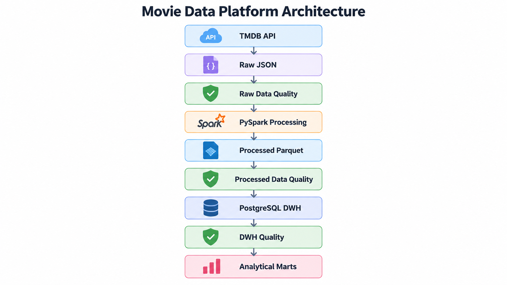
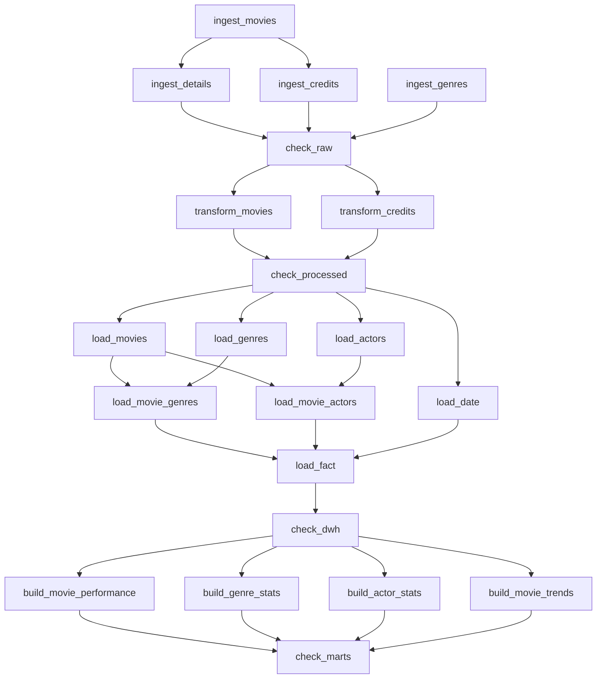
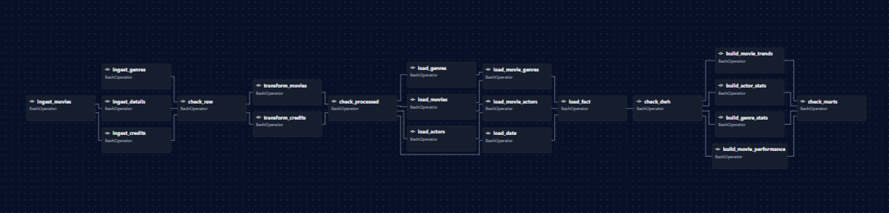

# Movie Data Platform

Pet-проект по построению ETL-пайплайна для сбора, обработки и анализа данных о фильмах из TMDB API.

Проект автоматически получает данные из внешнего API, обрабатывает их с помощью PySpark, выполняет проверки качества, загружает данные в PostgreSQL и строит аналитические витрины.

Для оркестрации используется Apache Airflow: все этапы объединены в единый DAG и запускаются по расписанию.

## Стек технологий

- Python
- PySpark
- SQL
- PostgreSQL
- Apache Airflow
- REST API
- Git
- Bash
- Linux / WSL
- uv

## Основные возможности

- автоматическая загрузка данных из TMDB API;
- формирование snapshot из 6000 уникальных фильмов;
- обработка данных с помощью PySpark;
- проверки качества raw и processed данных;
- загрузка данных в PostgreSQL DWH;
- построение аналитических витрин;
- оркестрация ETL-пайплайна через Apache Airflow;
- автоматический запуск DAG по расписанию;
- retry-механизм и идемпотентная обработка повторных запусков.

## Архитектура

Пайплайн построен как последовательность этапов от получения данных из TMDB API до формирования аналитических витрин.



Все этапы объединены в единый Apache Airflow DAG. Airflow управляет зависимостями между задачами, передает дату snapshot и запускает пайплайн по расписанию.

## Сбор данных

Основным источником данных является TMDB API.

Для каждого запуска формируется snapshot из 6000 уникальных фильмов. Для этого страницы `/movie/popular` загружаются последовательно до тех пор, пока не будет собрано необходимое количество уникальных `movie_id`.

Состав каждого snapshot фиксируется в файле `movie_ids.json`. Этот файл используется на последующих этапах пайплайна как единый список фильмов, которые должны попасть в обработку.

Для каждого фильма дополнительно загружаются:

- основные характеристики фильма;
- жанры;
- производственные компании;
- страны производства;
- языки;
- актерский состав;
- режиссеры.

Raw-данные сохраняются отдельно для каждого snapshot.

Пример структуры:

```text
data/raw/tmdb/<snapshot_date>/
├── movies/
├── movie_ids.json
├── details/
├── credits/
└── genres/
```

## Обработка данных

Raw-данные обрабатываются с помощью PySpark.

На этапе обработки исходные JSON-файлы преобразуются в набор структурированных датасетов:

- `movies` — основная информация о фильмах;
- `movie_genres` — связи фильмов с жанрами;
- `movie_companies` — связи фильмов с производственными компаниями;
- `movie_countries` — страны производства;
- `movie_languages` — языки фильмов;
- `movie_actors` — актерский состав;
- `movie_directors` — режиссеры.

Обработанные данные сохраняются в формате Parquet в отдельный processed-слой.

Пример структуры:

```text
data/processed/tmdb/<snapshot_date>/
├── movies/
├── movie_genres/
├── movie_companies/
├── movie_countries/
├── movie_languages/
├── movie_actors/
└── movie_directors/
```

## Проверки качества данных

В пайплайне реализованы проверки качества данных на нескольких этапах.

### Raw Data Quality

После загрузки данных из TMDB API выполняются проверки raw-слоя.

Проверяется:

- количество фильмов в snapshot;
- уникальность `movie_id`;
- наличие всех необходимых `details`;
- наличие всех необходимых `credits`;
- соответствие файлов списку из `movie_ids.json`;
- наличие данных о жанрах;
- отсутствие лишних файлов, не относящихся к текущему snapshot;
- наличие дубликатов `movie_id` при загрузке страниц TMDB.

Если критическая проверка не проходит, выполнение DAG останавливается.

### Processed Data Quality

После обработки данных PySpark выполняются проверки processed-слоя.

Проверяется:

- количество фильмов после обработки;
- наличие `NULL` в ключевых полях;
- отсутствие дубликатов;
- ссылочная целостность между датасетами;
- корректность диапазона `vote_average`;
- корректность значений `vote_count`.

Критические ошибки также останавливают дальнейшее выполнение пайплайна.

## Хранилище данных

После прохождения проверок processed-данные загружаются в PostgreSQL.

Хранилище построено с использованием таблицы фактов, измерений и bridge-таблиц для связей многие ко многим.

### Таблицы измерений

- `dim_movie` — информация о фильмах;
- `dim_actor` — информация об актерах;
- `dim_genre` — жанры;
- `dim_date` — календарное измерение.

### Таблица фактов

Основной исторической таблицей является `fact_movie_snapshot`.

Гранулярность таблицы — один фильм в рамках одного snapshot:

```text
(snapshot_date, movie_id)
```

Для каждого фильма сохраняются показатели на конкретную дату, в том числе:

- `popularity`;
- `vote_average`;
- `vote_count`;
- `budget`;
- основной актер;
- основной жанр;
- язык фильма.

Благодаря хранению `snapshot_date` можно отслеживать изменение показателей одного и того же фильма во времени.

Пример:

```text
movie_id | snapshot_date | popularity
---------+---------------+-----------
100      | 2026-10-08    | 25.4000
100      | 2026-10-09    | 31.8000
100      | 2026-10-13    | 42.1000
```

## Аналитические витрины

На основе данных из DWH строятся аналитические витрины для анализа состояния фильмов, жанров и актеров, а также изменения показателей во времени.

### `mart_movie_performance`

Содержит данные о каждом фильме в рамках конкретного snapshot:

- популярность (`popularity`);
- средний рейтинг (`vote_average`);
- количество пользовательских оценок (`vote_count`);
- бюджет;
- дату и год выхода;
- оригинальный язык;
- основного актера;
- основной жанр.

Гранулярность витрины — один фильм в рамках одного snapshot.

### `mart_genre_stats`

Содержит агрегированные показатели по жанрам:

- количество фильмов (`movie_count`);
- количество фильмов, имеющих пользовательские оценки (`rated_movie_count`);
- среднюю популярность (`avg_popularity`);
- максимальную популярность (`max_popularity`);
- средний рейтинг (`avg_vote_average`);
- средневзвешенный рейтинг (`weighted_vote_average`);
- общее количество пользовательских оценок (`total_vote_count`);
- средний бюджет (`avg_budget`).

### `mart_actor_stats`

Содержит агрегированные показатели по актерам:

- количество фильмов актера в snapshot (`movie_count`);
- среднюю популярность фильмов (`avg_popularity`);
- максимальную популярность фильма (`max_popularity`);
- средний рейтинг фильмов (`avg_vote_average`);
- средневзвешенный рейтинг (`weighted_vote_average`);
- суммарное количество пользовательских оценок (`total_vote_count`).

### `mart_movie_trends`

Используется для анализа динамики показателей фильмов между snapshot.

Для каждого фильма рассчитываются:

- текущее и предыдущее значение `popularity`;
- изменение `popularity`;
- текущее и предыдущее значение `vote_average`;
- изменение рейтинга;
- текущее и предыдущее значение `vote_count`;
- изменение количества пользовательских оценок.

## Оркестрация

Все этапы ETL-пайплайна объединены в единый Apache Airflow DAG.



Airflow управляет зависимостями между задачами и позволяет выполнять независимые этапы параллельно.

DAG автоматически запускается по вторникам, четвергам и субботам в 15:00 по московскому времени. Дата snapshot определяется Airflow для каждого scheduled run и передается всем этапам пайплайна.

### DAG в Apache Airflow



## Надежность и идемпотентность

Пайплайн спроектирован так, чтобы отдельные этапы можно было безопасно перезапускать после временных ошибок.

На этапе загрузки данных:

- уже существующие raw-файлы не скачиваются повторно;
- отсутствующие файлы можно дозагрузить отдельным повторным запуском task;
- для временных ошибок TMDB API используется retry-механизм;
- обрабатываются timeout, сетевые ошибки, HTTP 429 и серверные ошибки 5xx;
- между повторными попытками используется exponential backoff.

Загрузка данных в DWH также реализована идемпотентно: повторный запуск для одного и того же `snapshot_date` не должен создавать дубликаты.

Такой подход позволяет восстанавливать пайплайн с места сбоя без необходимости повторно выполнять весь процесс с самого начала.

## Структура проекта

```text
movie-data-platform/
├── dags/
│   └── movie_pipeline.py
├── data/
│   ├── raw/
│   └── processed/
├── sql/
│   └── marts/
├── src/
│   ├── config/
│   ├── ingestion/
│   ├── processing/
│   ├── loading/
│   └── quality/
├── tests/
├── pyproject.toml
├── uv.lock
└── README.md
```

## Текущий статус и планы развития

На данный момент реализован полный ETL-пайплайн:

- получение данных из TMDB API;
- формирование исторических snapshot;
- обработка данных с помощью PySpark;
- проверки качества raw и processed данных;
- загрузка данных в PostgreSQL DWH;
- построение аналитических витрин;
- оркестрация процессов с помощью Apache Airflow;
- автоматический запуск по расписанию;
- retry-механизм и идемпотентные повторные запуски.

В дальнейшем планируется:

- провести EDA собранных данных;
- добавить визуализацию и dashboard;
- расширить покрытие unit- и integration-тестами;
- настроить CI через GitHub Actions;
- контейнеризировать проект с помощью Docker;
- сохранять историю результатов Data Quality;
- перейти от полного пересчета аналитических витрин к инкрементальному обновлению.